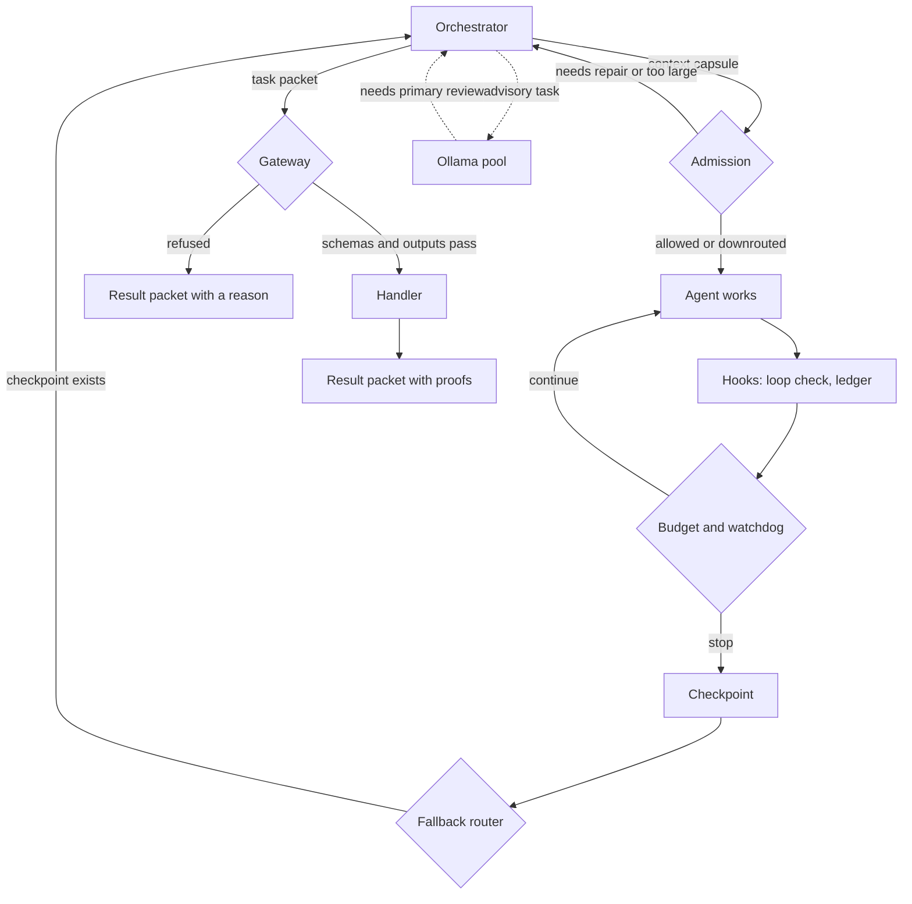

# agent-gateway

**[Read the wiki](https://github.com/dboles99/agent-gateway/wiki)** for how it works, the evidence, the design decisions and the limits.

Governance plumbing for coding agents: it decides what an agent may be asked to do, notices when the agent stops making progress, and gives other programs one checked way to dispatch work.

**简体中文：** agent-gateway 是面向编码智能体的治理工具包。它在任务开始前检查任务是否合格、预算是否足够，在运行中发现重复调用和停滞，并通过统一的任务包接口派发工作。每一次拒绝都会返回结构化结果，而不是抛出异常。

**繁體中文：** agent-gateway 是面向程式編碼代理的治理工具包。它在任務開始前檢查任務是否合格、預算是否足夠，在執行中發現重複呼叫與停滯，並透過統一的任務封包介面派發工作。每一次拒絕都會回傳結構化結果，而不是拋出例外。

Designed and authored by Daniel Boles; implemented with coding agents.

## What it does

An agent left alone will happily spend a budget repeating the same search. This package puts small, deterministic checks around that, written as plain functions and a command line, so hooks and orchestrators can call them. No check here calls a model.

| Part | Purpose |
| --- | --- |
| Admission | Sends back a request with no acceptance criteria or stop condition, refuses one that is too large, and moves bounded work off the primary model. |
| Budget | Reports `NORMAL`, `SOFT`, `HARD` or `EMERGENCY` against tokens, turns, tool calls and time. |
| Watchdog | Reports `CONTINUE`, `WARN` or `CHECKPOINT_AND_STOP` from time and activity since the last proof of progress. |
| Loop fingerprints | Hashes a tool call, ignoring timestamps and nonces, and flags an identical call repeated past a limit. |
| Fallback router | One-way switch to a fallback orchestrator, allowed only when a checkpoint exists. |
| Checkpoints and ledger | Atomic JSON checkpoints and an append-only JSONL event log, in one run directory however many checkouts you have. |
| Cache keys | Content-addressed keys, and a rule that only a validated entry with matching dependencies is reused. |
| Rule packs | A small closed expression language in YAML, with no `eval`. A rule that asks for missing data does not fire and is reported. |
| Capability gateway | Dispatches a JSON task packet to a declared handler. Enforces input schema, output schema and required outputs. Every outcome, including every refusal, is a valid result packet. |
| Agent pool | Optional. Sends advisory work to a local Ollama model under a contract covering role, privacy class and write permission. Off by default. |
| Agent definitions | Loads agent files with YAML frontmatter and refuses unsafe combinations, such as limiting write scope while skipping review. |

## How a task flows



## Quick start

Python 3.12 or newer.

```bash
git clone https://github.com/dboles99/agent-gateway.git
cd agent-gateway
python -m venv .venv
.venv/bin/pip install -e ".[dev]"     # Windows: .venv\Scripts\pip
.venv/bin/python examples/quickstart.py
```

The quick start runs offline and writes only to a temporary folder. Its output:

```text
admission: DOWNROUTE to worker: primary model not required for bounded implementation
budget: HARD
loop: deny repeat call: True
watchdog: CHECKPOINT_AND_STOP
fallback: fallback, resume at ['rerun tests']
DECISION ACCEPT [MEDIUM] by RG-004 of RELEASE-GATE
  MATCHED RG-004: change.tests_passed == true and change.review_confidence >= 0.9
    change.review_confidence = 0.95
    change.tests_passed = True
DECISION none: no rule matched in RELEASE-GATE
dispatch: passed [{'name': 'word_count', 'value': 4}]
dispatch: blocked capability_unbuilt
pool: completed, demo:latest, review required: True
```

From the command line:

```bash
agent-gateway gateway capabilities --config examples/capabilities.yaml
agent-gateway gateway execute examples/task_packet.json --config examples/capabilities.yaml
agent-gateway governance admit examples/context_capsule.yaml
agent-gateway governance evaluate-rules examples/rules/release-gate.yaml --context examples/rules/context-pass.json
```

`execute`, `admit` and `evaluate-rules` use exit codes as gates. `gateway validate` and `gateway execute` exit 2 when a packet cannot be read at all, and 1 when it was read and refused.

To warn an agent host about repeated tool calls, point a PreToolUse hook at:

```bash
agent-gateway governance check-loop-hook loop_state.json
```

It always allows the call and adds a warning past the limit.

## Configuration

| Variable | Meaning | Default |
| --- | --- | --- |
| `AGENT_GATEWAY_RUN_DIR` | Run directory for relative ledger and checkpoint paths | `~/.agent_gateway/runs/current` |
| `AGENT_GATEWAY_CAPABILITIES` | Capability config | `./capabilities.yaml` |
| `AGENT_GATEWAY_POOL_REGISTRY` | Pool model registry | `./agent-pool.yaml` |
| `AGENT_GATEWAY_POOL_ROLES` | Pool roles | `./agent-roles.yaml` |
| `AGENT_GATEWAY_POOL_ENABLED` | Overrides `defaults.enabled` | file value |
| `AGENT_GATEWAY_POOL_MODE` | Overrides `defaults.mode` | file value |
| `AGENT_GATEWAY_POOL_TELEMETRY` | Path for metadata-only telemetry | off |
| `AGENT_GATEWAY_ALLOW_CLOUD` | Permit cloud-execution models | off |
| `AGENT_GATEWAY_OLLAMA_URL` | Ollama base URL | `http://127.0.0.1:11434` |
| `AGENT_GATEWAY_ENV_FILE` | `.env` file for the command line to load | `./.env` |

The command line loads the `.env` file. Importing the library does not, and it does not read configuration, touch the network or write a file.

## Design notes

- **Refusals are data.** A caller in another process cannot read a traceback, and one exit code cannot say which of eleven things went wrong. `run_task_packet` does not raise, and each refusal carries a distinct reason.
- **Absent, broken and refused are different facts.** A capability with no handler is `capability_unbuilt`, which is a normal state. A handler that will not import is `handler_unresolvable`, which is a defect. They must not read alike.
- **A declaration no code reads is an instruction, not a mechanism.** Required outputs are checked against what the handler produced, so a handler that says `passed` without producing them gets `failed`.
- **Missing data never looks like a pass.** Rule conditions use three-valued logic. A check that did not happen is reported as unknown, never as false.
- **Model output is untrusted.** Result ids, the review flag and metrics come from the caller, so a model cannot relabel its own result or clear the review requirement. Telemetry records metadata only, never prompts or output.
- **The registry has the last word.** The pool checks where a model really runs, so a task cannot declare `local` to send confidential work to a cloud model.

## Limits

- These are checks and records, not a sandbox. Nothing here stops a process that ignores them.
- `ContextLease` compares exact path strings, and its read and byte limits are declared but not enforced.
- `handler:` paths in the capability config are imported and called, so treat that file as code.
- Files use no locking. Loop counters and checkpoints are safe against a crash mid-write, but concurrent writers can lose an update.
- Token figures are estimates supplied by the caller. This package does not count tokens.
- Model roles are `primary`, `fallback`, `worker` and `light`. Mapping them to real models is up to you.
- Pool fields such as `approved_task_types` are descriptive and not enforced. `model_allowed` in `pool/registry.py` is the rule that is.
- The pool speaks Ollama only.
- Tested on Windows with Python 3.12. Not tested on Linux or macOS.

## Tests

```bash
pytest
```

Last run, on Windows with Python 3.12: 241 passed, 1 skipped.

`tests/fake_ollama.py` runs a real HTTP server on a local port, so the Ollama clients are exercised through a socket and not a mocked call. `tests/test_live_ollama.py` is the one skipped test: it needs `AGENT_GATEWAY_LIVE_MODEL` to name a pulled model. Run once against a local Ollama model, it passed in 120 seconds.

## Licence

Apache-2.0. Copyright 2026 Daniel Boles. See [LICENSE](LICENSE).
